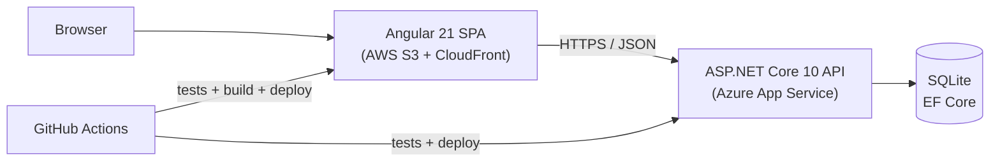
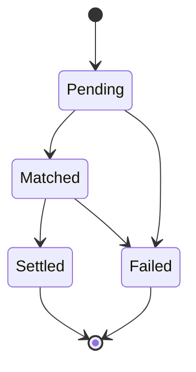

# SettleTrack

A securities settlement tracker: an Angular dashboard on top of an ASP.NET Core API, built to mirror the kind of back-office tooling used in post-trade operations.

A trade moves through a strict lifecycle (`Pending → Matched → Settled`, or `Failed`). The API enforces the rules, and the UI only offers the actions that are valid for each trade.

**Live API:** https://settletrack-api-davidset.azurewebsites.net/api/trades/summary
*(Free App Service plan: the first request after inactivity can take 10 to 20 seconds.)*

## Architecture



> Status: the API is deployed on Azure. The AWS front-end deployment is in progress.

## Trade lifecycle



`Settled` and `Failed` are final. The rule lives in the domain entity (`Trade.TransitionTo`), so no controller or service can bypass it. An invalid transition returns **409 Conflict** with a `ProblemDetails` body.

## Features

- Dashboard with summary cards: total, per status, settlement rate, trades due today and overdue
- Filter by status and ISIN prefix
- Action buttons generated from `allowedTransitions` returned by the API
- "New trade" form with reactive-form validation (ISIN format, currency code, no past settlement date)
- Server-side validation errors displayed in the UI

## API

| Method | Route | Description |
|--------|-------|-------------|
| GET | `/api/trades?status=&isin=` | List trades, optional filters |
| GET | `/api/trades/summary` | Counts, settlement rate, due today, overdue |
| GET | `/api/trades/{id}` | One trade |
| POST | `/api/trades` | Create a trade (400 on validation errors) |
| PATCH | `/api/trades/{id}/status` | Change status (409 if the transition is not allowed) |

## Tech stack

- **Backend:** ASP.NET Core Web API (.NET 10), EF Core 10 with SQLite, `ProblemDetails` error handling, `TimeProvider` for testable dates
- **Frontend:** Angular 21 (standalone components, signals, new control flow, reactive forms, typed `HttpClient`)
- **Tests:** xUnit (23 tests: domain rules and services on in-memory SQLite) and Vitest (11 tests: API client, form validation, app)
- **CI/CD:** GitHub Actions: tests and deployment for the API (Azure App Service), tests and build for the front end
- **Cloud:** Azure App Service (API), AWS S3 + CloudFront (front end)

## Run it locally

Prerequisites: .NET 10 SDK, Node.js 22+, Angular CLI.

```powershell
# Terminal 1: API on http://localhost:5001
dotnet run --project SettleTrack.Api

# Terminal 2: front end on http://localhost:4200
cd settletrack-frontend
npm install
ng serve
```

The database (`settletrack.db`) is created and seeded with 12 sample trades on first start.

## Run the tests

```powershell
dotnet test
cd settletrack-frontend
ng test --no-watch
```

## Design decisions

- **Business rules in the domain, not in the controller.** The state machine is in `Trade`, covered by unit tests.
- **The API drives the UI.** The front end does not duplicate the transition rules: it renders `allowedTransitions` from the response.
- **Testable time.** "Due today" and "overdue" use an injected `TimeProvider`, so tests control the date.
- **Configuration through environment.** CORS origin and connection string come from app settings, not code.

## Known limitations

- SQLite is used to keep the project simple. On Azure it is stored in `/home`, which persists across deployments, but a production system would use a managed database.
- No authentication: this is a demo, not a multi-user system.
- The free hosting plan puts the API to sleep after inactivity.